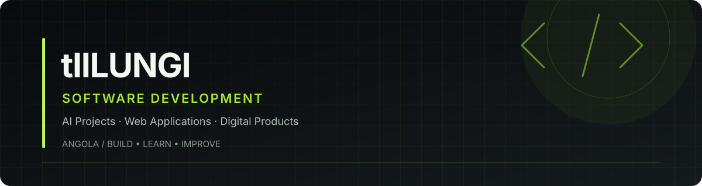

<!--
GITHUB PROFILE README — tIILUNGI
Visual direction: Dark Premium / Front-End / Minimal
Before publishing: remove technologies you don't use and verify project descriptions.
-->

 

# tIILUNGI

### FRONT-END DEVELOPER · SOFTWARE DEVELOPER

**EN** — Building digital experiences through code, design, and continuous learning.

**PT** — A construir experiências digitais através de código, design e aprendizagem contínua.

 

[PORTFOLIO](https://ebenezervc.netlify.app/) &nbsp;·&nbsp; [GITHUB](https://github.com/tIILUNGI)

---

## 01 / ABOUT ME

**EN**

I'm a developer interested in building modern web interfaces and practical digital products. I enjoy exploring new technologies, solving problems, and turning ideas into working applications.

**PT**

Sou desenvolvedor com interesse na criação de interfaces web modernas e produtos digitais práticos. Gosto de explorar novas tecnologias, resolver problemas e transformar ideias em aplicações funcionais.

---

## 02 / TECH STACK

### FRONT-END DEVELOPMENT

<!-- Keep only technologies you actually use or are actively learning. -->

  

### FRAMEWORKS & LIBRARIES

<!-- Remove any icon for a technology you do not use. -->

  

### TOOLS & WORKFLOW

  

---

## 03 / SELECTED PROJECTS

### ATLAS AI
**AI Agents for Education**

An education-focused project exploring the use of artificial intelligence in learning experiences.

[Explore my repositories →](https://github.com/tIILUNGI?tab=repositories)

### SALYA
**Business Management Software**

A product project focused on business management and digital workflows.

[Explore my repositories →](https://github.com/tIILUNGI?tab=repositories)

### GESTORA
**Management Systems**

A collection of management-system development work. Explore the repositories for implementation details.

[Explore my repositories →](https://github.com/tIILUNGI?tab=repositories)

---

## 04 / CURRENT FOCUS

**EN**
- Improving front-end development skills.
- Building and refining web interfaces.
- Exploring software development and AI-powered products.
- Improving code quality and project documentation.

**PT**
- Aprofundar competências em desenvolvimento Front-End.
- Construir e aperfeiçoar interfaces web.
- Explorar desenvolvimento de software e produtos com IA.
- Melhorar a qualidade do código e a documentação dos projectos.

---

## 05 / LET'S CONNECT

Interested in collaborating on a project or discussing a technology opportunity?

Tens um projecto interessante ou uma oportunidade tecnológica? Vamos conversar.

[**VIEW PORTFOLIO**](https://ebenezervc.netlify.app/)

[GitHub](https://github.com/tIILUNGI)

 

BUILD WITH PURPOSE. KEEP IMPROVING.

CONSTRUIR COM PROPÓSITO. EVOLUIR SEMPRE.

